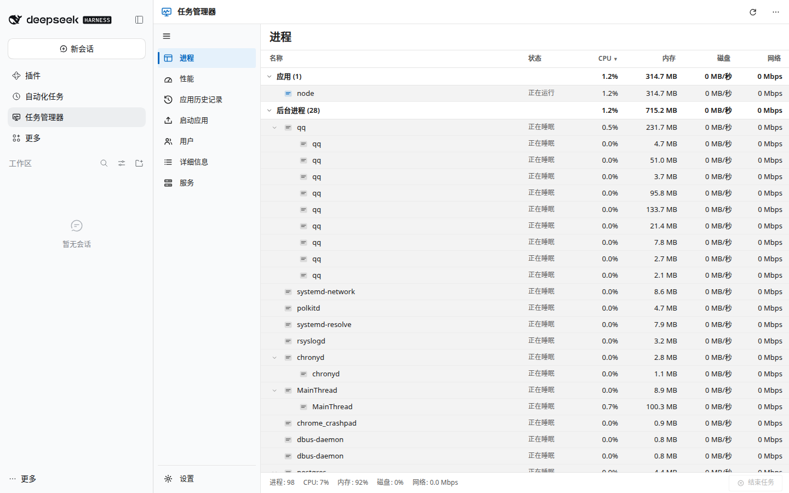
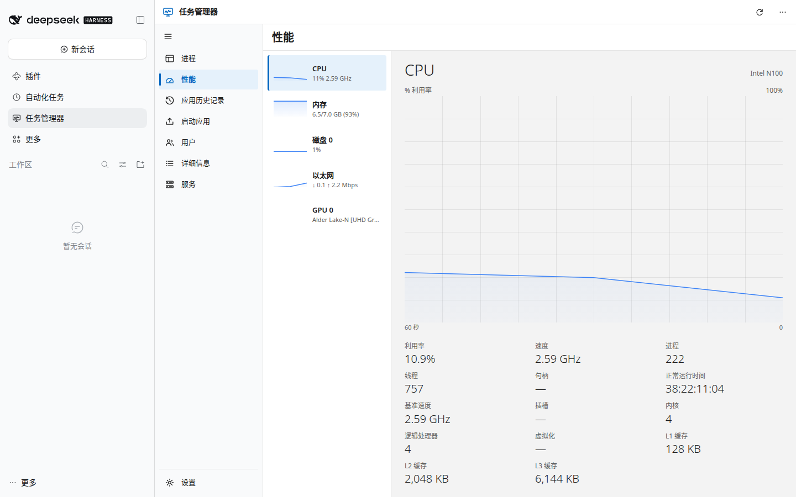
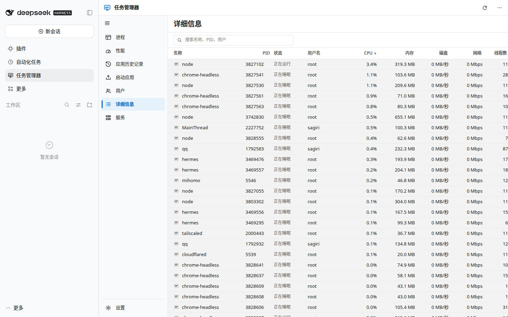
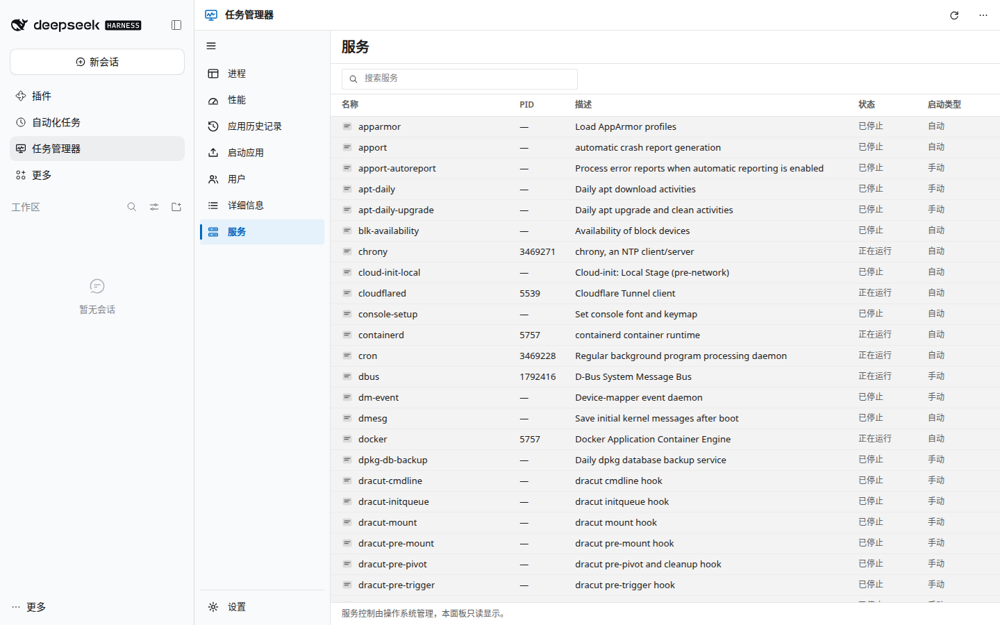
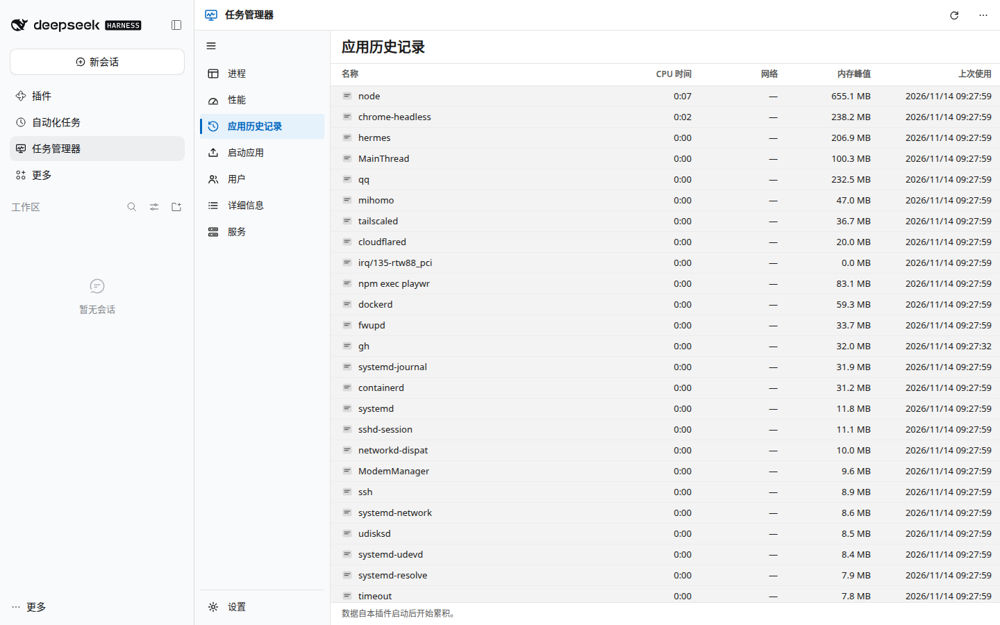
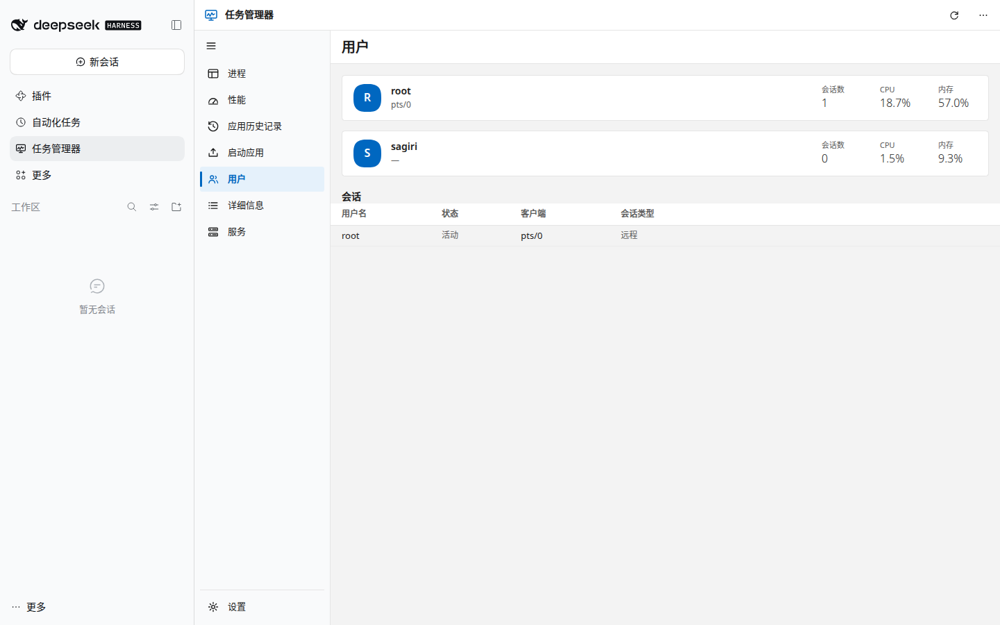
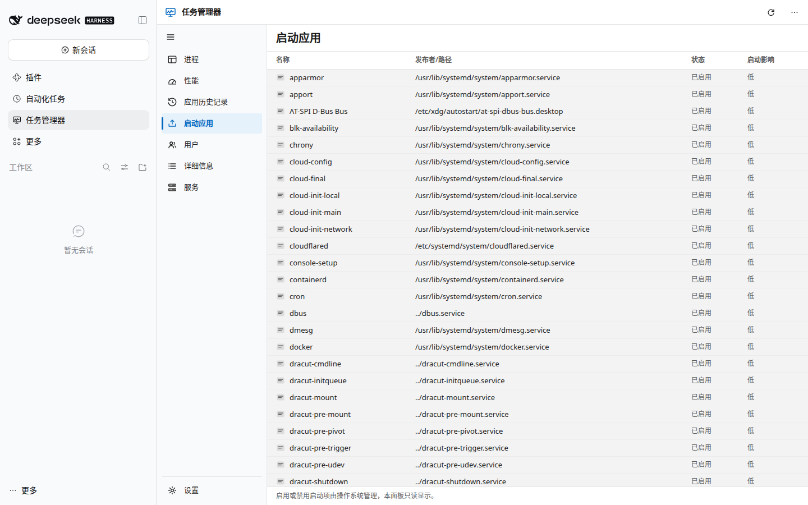
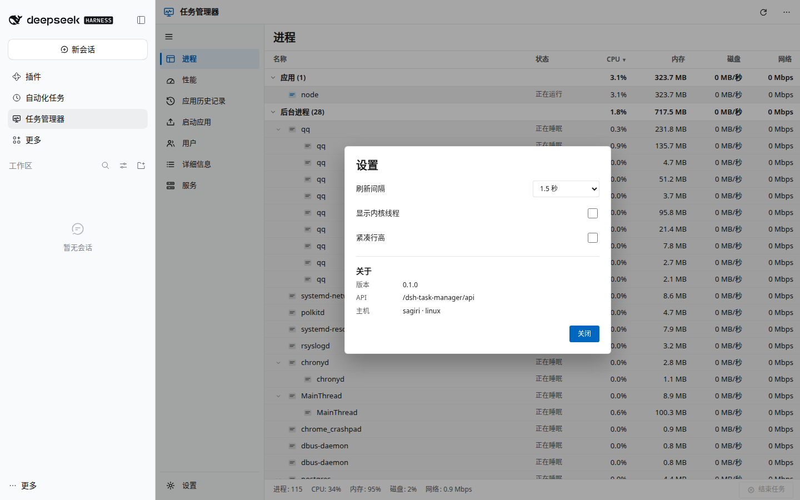
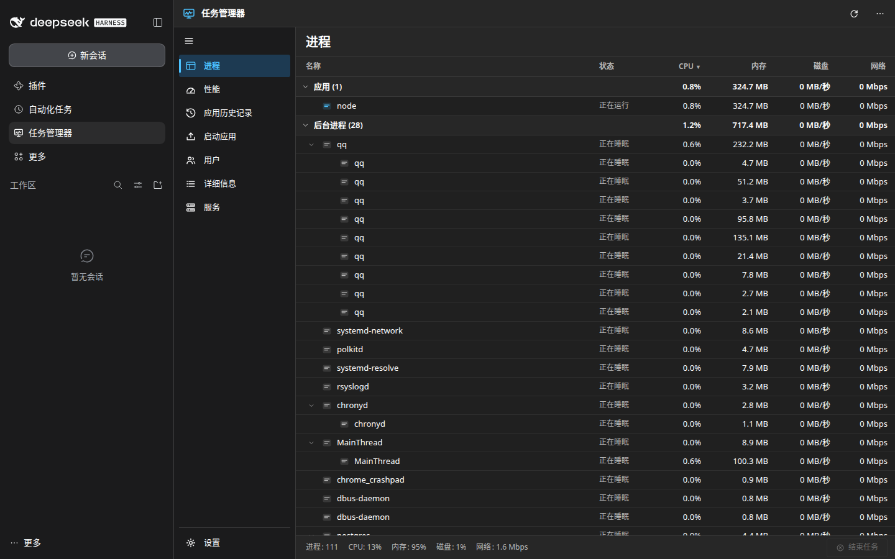

# Task Manager for DeepSeek Harness

[中文说明](./README.zh-CN.md)

A Windows 11 style **Task Manager** inside the DeepSeek Harness Web GUI. It adds a
`任务管理器` / `Task Manager` entry to the left sidebar and opens a full panel with
live CPU, memory, disk and network graphs, a grouped process table, app history,
startup entries, users, a sortable details table, and services — built on the
mature, MIT-licensed [`systeminformation`](https://github.com/sebhildebrandt/systeminformation)
library plus a Linux `/proc` fast path.

[](https://www.npmjs.com/package/@ds-hu/dsh-task-manager)
[](./LICENSE)
[](https://github.com/ds-hu/dsh-task-manager/actions/workflows/ci.yml)

## Screenshots

| Processes | Performance |
| --- | --- |
|  |  |
| **Details** | **Services** |
|  |  |
| **App history** | **Users** |
|  |  |
| **Startup apps** | **Settings** |
|  |  |

Dark theme: 

## Pages

- **进程 / Processes** — grouped `应用` / `后台进程` / `系统进程`, live CPU, memory,
  disk and network columns, group totals, expandable child processes, sortable
  headers, right-click actions, and a Win11 status bar.
- **性能 / Performance** — CPU, memory, disk and network with 60-second canvas
  graphs, per-core view, and the Win11 statistics grid.
- **应用历史记录 / App history** — CPU seconds and peak memory accumulated since
  the plugin started (real data, no placeholders).
- **启动应用 / Startup apps** — XDG autostart entries and enabled systemd units
  (read-only, by design).
- **用户 / Users** — signed-in users with their CPU and memory share.
- **详细信息 / Details** — searchable, sortable table with PID, user, threads,
  priority and command line.
- **服务 / Services** — searchable systemd service list with state and start mode.
- **设置 / Settings** — refresh interval, kernel-thread visibility, compact rows.

Everything follows the host light/dark theme and the host locale (Chinese and
English dictionaries are bundled).

## Install

The plugin is a DSH bundle. Install it into the Web profile with the CLI:

```bash
dsh plugin --profile web add @ds-hu/dsh-task-manager
```

or with the Plugin Manager in the Web GUI (`设置 → 插件 → 添加`), then reload the
page. The `任务管理器` entry appears in the left sidebar.

Requirements: DSH `0.2.x` (Web profile), Node.js ≥ 20.19. No native build step,
no system dependency beyond the OS itself.

## Configuration

The bundle row accepts optional `config`; every value is validated and clamped,
so an invalid value falls back to the default instead of failing activation.

```yaml
- id: task-manager
  name: '@ds-hu/dsh-task-manager'
  config:
    refreshIntervalMs: 1500        # browser poll hint, 500–10000
    maxProcesses: 400              # rows returned, 50–2000
    sampleCacheMs: 800             # Host sample cache, 200–5000
    allowKillSystemProcesses: false # keep uid-0 processes protected
```

## How it works

The Host half registers one web-server prefix (`/dsh-task-manager/api/*`) and
samples the operating system **on demand** — no background timer, nothing runs
while the panel is closed. The browser half polls only while the panel is mounted
and the tab is visible. The Linux fast path reads `/proc` in one pass (~10–30 ms
for ~250 processes); other platforms use `systeminformation.processes()`.

See [docs/ARCHITECTURE.md](./docs/ARCHITECTURE.md) for the design, the library
comparison, measured timings, and the security model. The API contract is in
[docs/API.md](./docs/API.md); the UI specification is in
[docs/UI-SPEC.md](./docs/UI-SPEC.md).

## Security

- Same-origin JSON API; mutations require a matching `Origin`.
- **End task** refuses PID 1, the DSH Host process and its parent, refuses uid-0
  processes unless `allowKillSystemProcesses` is enabled, refuses recycled PIDs
  (stale `startTime`), and requires `force: true` for `SIGKILL`.
- Services and startup entries are read-only; the plugin never touches them.
- No credentials, sessions or conversation content are read.

## Development

```bash
npm install
npm run build        # build lib/client.js with esbuild
npm test             # host unit tests + mount parity + client smoke
node test/package.mjs
```

End-to-end tests use an isolated DSH instance (never the production profile):

```bash
./scripts/e2e-instance.sh restart 3090
TM_URL="$(./scripts/e2e-instance.sh url)" npx playwright test
./scripts/e2e-instance.sh stop
```

## License

MIT. `systeminformation` is MIT and used unmodified; attribution is in
[NOTICE](./NOTICE). The plugin icon and every glyph are original SVG. Windows 11
Task Manager is a Microsoft product; this is an independent, unofficial
interface and is not affiliated with Microsoft.
