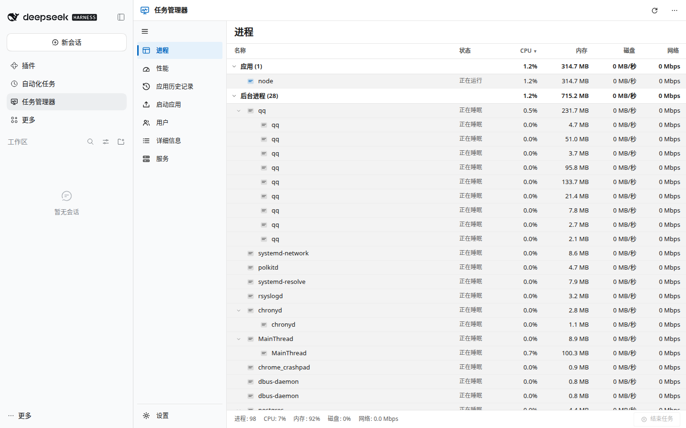
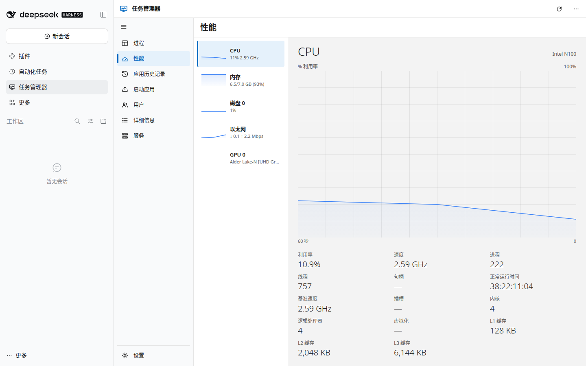
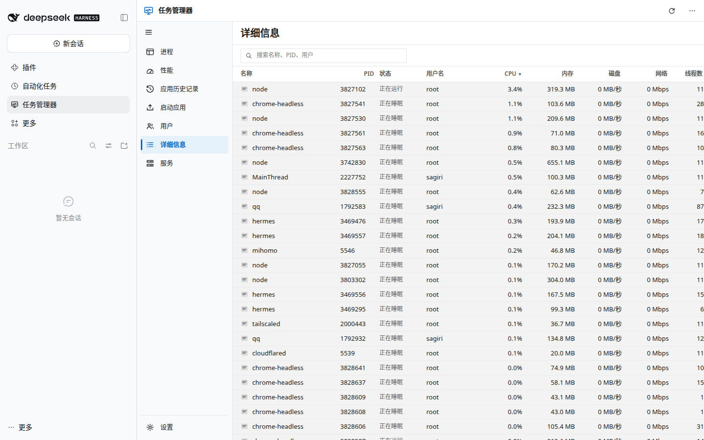
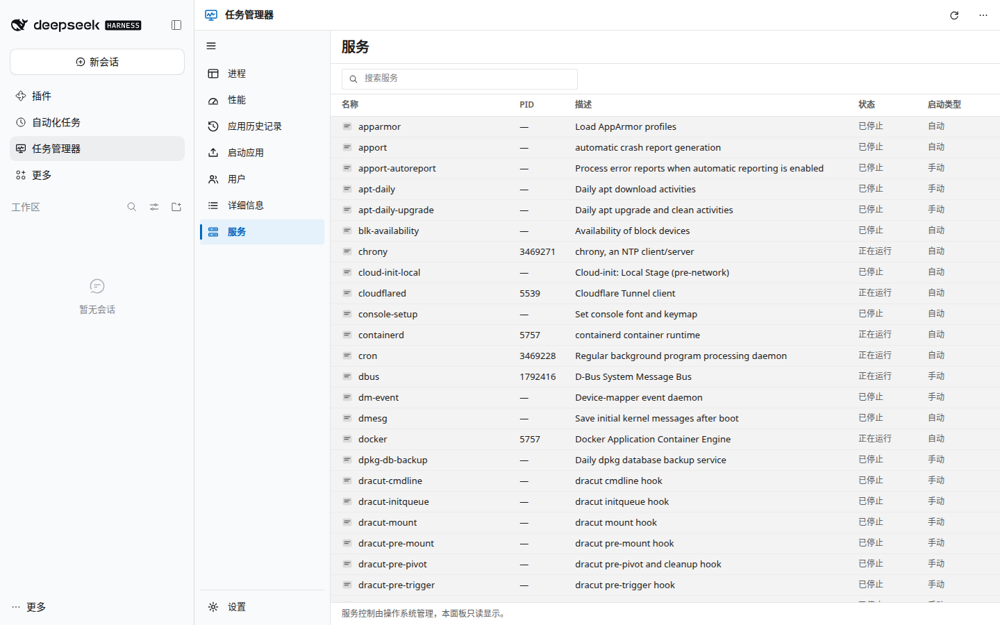
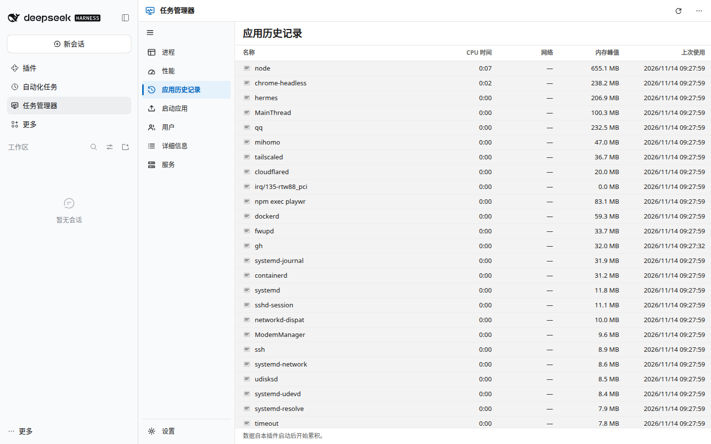
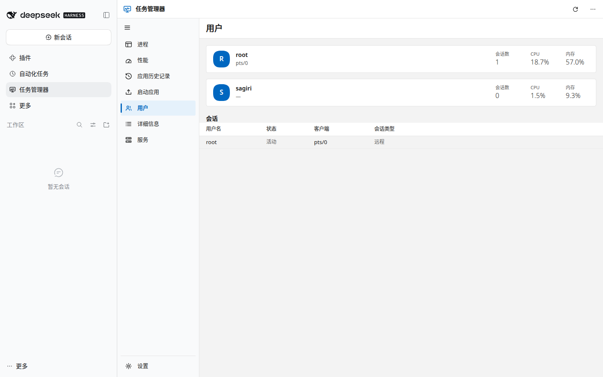
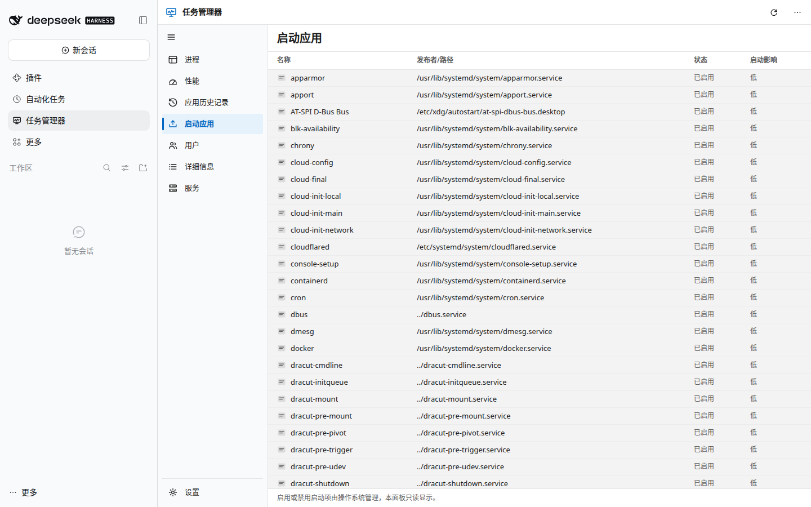
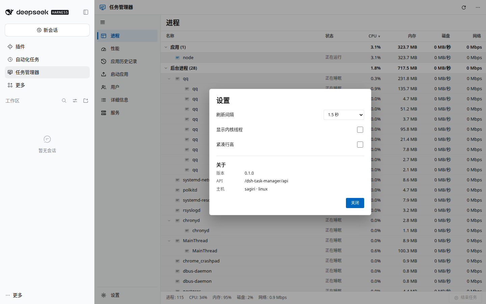
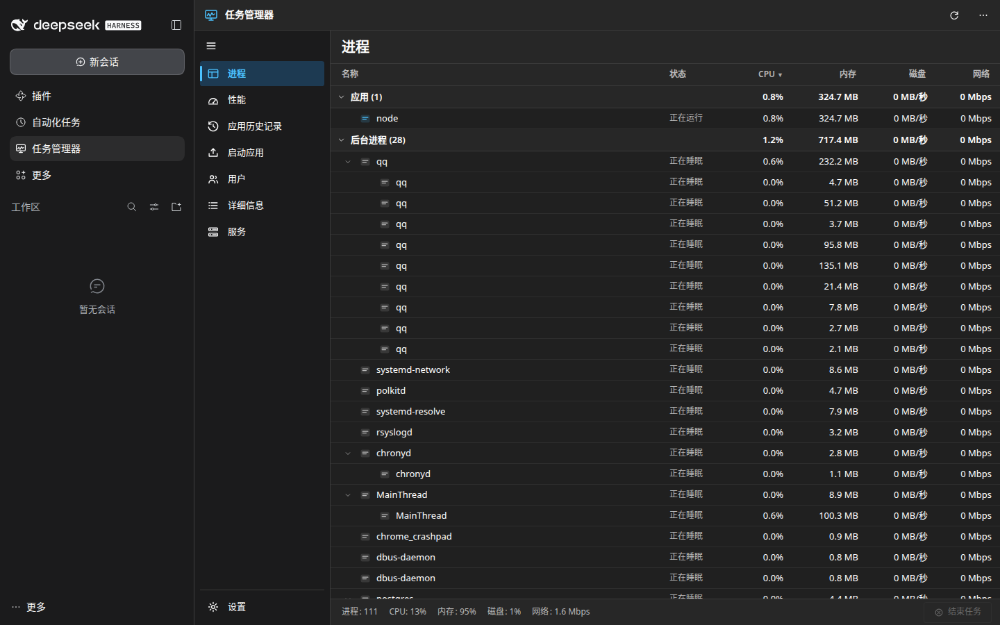

# DeepSeek Harness 任务管理器

[English](./README.md)

在 DeepSeek Harness Web 界面的左侧边栏中加入一个 **Windows 11 风格的任务管理器**。
入口名为「任务管理器」，点开后是一个完整面板：实时 CPU / 内存 / 磁盘 / 网络图表、
分组进程表、应用历史记录、启动项、用户、可排序的详细信息表和服务页。底层使用成熟的
MIT 协议库 [`systeminformation`](https://github.com/sebhildebrandt/systeminformation)，
并为 Linux 增加了 `/proc` 快速路径。

[](https://www.npmjs.com/package/@ds-hu/dsh-task-manager)
[](./LICENSE)
[](https://github.com/ds-hu/dsh-task-manager/actions/workflows/ci.yml)

## 截图

| 进程 | 性能 |
| --- | --- |
|  |  |
| **详细信息** | **服务** |
|  |  |
| **应用历史记录** | **用户** |
|  |  |
| **启动应用** | **设置** |
|  |  |

深色主题：

## 页面

- **进程** — 按「应用 / 后台进程 / 系统进程」分组，实时 CPU、内存、磁盘、网络列，
  分组汇总、可展开的子进程、列排序、右键菜单，以及 Win11 风格底部状态栏。
- **性能** — CPU、内存、磁盘、网络 60 秒 Canvas 图表，可切换逻辑处理器视图，
  以及 Win11 统计信息网格。
- **应用历史记录** — 插件启动后累积的 CPU 时间与内存峰值（真实数据，不做假）。
- **启动应用** — XDG 自启动项与已启用的 systemd 单元（只读，刻意如此）。
- **用户** — 已登录用户及其 CPU、内存占用。
- **详细信息** — 可搜索、可排序的完整表格：PID、用户名、线程数、优先级、命令行。
- **服务** — 可搜索的 systemd 服务列表，显示运行状态与启动类型。
- **设置** — 刷新间隔、是否显示内核线程、紧凑行高。

面板跟随宿主主题（浅色 / 深色）与宿主语言（内置中英文字典）。

## 安装

这是一个 DSH bundle，用 CLI 安装到 Web profile：

```bash
dsh plugin --profile web add @ds-hu/dsh-task-manager
```

也可以在 Web 界面中通过「设置 → 插件 → 添加」安装，然后刷新页面。左侧边栏会出现
「任务管理器」入口。

要求：DSH `0.2.x`（Web profile），Node.js ≥ 20.19。无需原生编译，除操作系统本身外
没有系统依赖。

## 配置

bundle 行可以带可选的 `config`，每个值都会被校验并夹取到合法区间，非法值回退默认值，
不会导致插件激活失败。

```yaml
- id: task-manager
  name: '@ds-hu/dsh-task-manager'
  config:
    refreshIntervalMs: 1500         # 浏览器轮询间隔，500–10000
    maxProcesses: 400               # 返回的进程行数上限，50–2000
    sampleCacheMs: 800              # Host 采样缓存，200–5000
    allowKillSystemProcesses: false # 默认保护 uid 0 的系统进程
```

## 工作原理

Host 端只注册一个 Web 路由前缀（`/dsh-task-manager/api/*`），并且**按需采样**：
面板关闭时没有任何后台定时器。浏览器端只在面板挂载且标签页可见时轮询。Linux 下用一次
`/proc` 遍历计算进程 CPU（约 250 个进程 10–30 ms）；其他平台回退到
`systeminformation.processes()`。

设计、库选型对比、实测耗时与安全模型见
[docs/ARCHITECTURE.md](./docs/ARCHITECTURE.md)；接口契约见
[docs/API.md](./docs/API.md)；UI 规范见 [docs/UI-SPEC.md](./docs/UI-SPEC.md)。

## 安全

- 仅接受同源 JSON 请求；写操作要求 `Origin` 匹配。
- **结束任务**会拒绝 PID 1、DSH Host 进程及其父进程；默认拒绝 uid 0 的系统进程
  （除非开启 `allowKillSystemProcesses`）；拒绝 PID 复用（`startTime` 不匹配）；
  `SIGKILL` 需要显式 `force: true`。
- 服务与启动项只读，插件不会修改它们。
- 不读取任何凭据、会话或对话内容。

## 开发

```bash
npm install
npm run build        # 用 esbuild 构建 lib/client.js
npm test             # Host 单元测试 + 挂载一致性 + 客户端冒烟
node test/package.mjs
```

端到端测试使用隔离的 DSH 实例（绝不碰生产 profile）：

```bash
./scripts/e2e-instance.sh restart 3090
TM_URL="$(./scripts/e2e-instance.sh url)" npx playwright test
./scripts/e2e-instance.sh stop
```

## 许可证

MIT。`systeminformation` 为 MIT 协议且未做修改，署名见 [NOTICE](./NOTICE)。
插件图标与所有图形均为本项目原创 SVG。Windows 11 任务管理器是微软产品；本项目是
独立的非官方界面，与微软无隶属关系。
